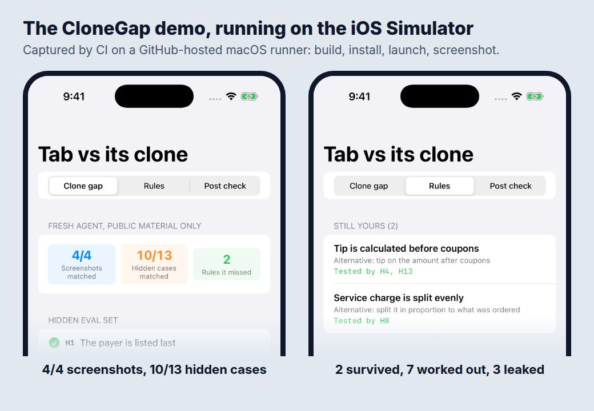
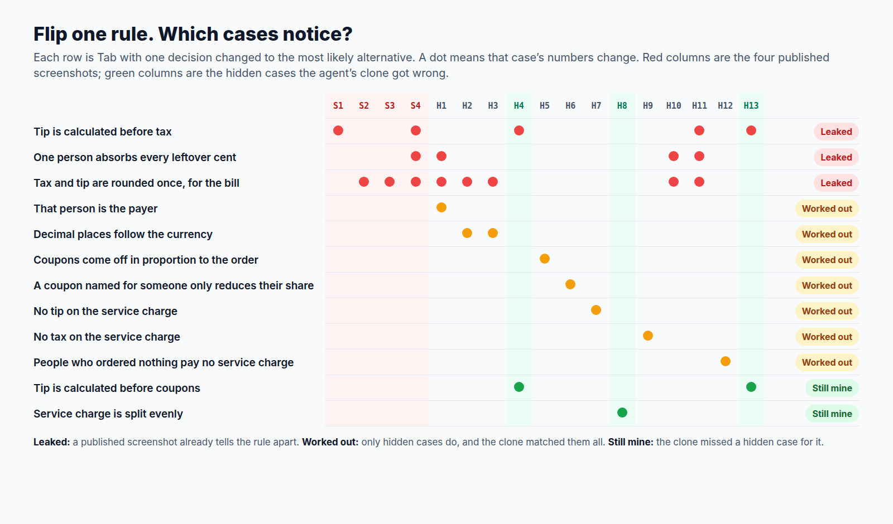

# CloneGap

**How much of your app can an AI agent rebuild from what you've posted? This package measures it.**

Article: [I Asked an AI Agent to Clone an App From Its Public Posts. Only 2 of 12 Rules Survived.](https://medium.com/@er.rajatlakhina/i-asked-an-ai-agent-to-clone-an-app-from-its-public-posts-only-2-of-12-rules-survived-6c7ce4dcaf4b)

When an agent can clone an app in a weekend, the UI and the feature list stop being a moat. In [Fatbobman's Swift Weekly #157](https://weekly.fatbobman.com/p/fatbobmans-swift-weekly-157), Fatbobman worries that Build in Public will turn back into Build in Private now that AI can rebuild an app from the screenshots its developer shares. This repo is a red-team exercise to find out what a copy actually gets.

**Tab** is a fictional bill-splitting app with twelve product rules (who absorbs leftover cents, whether the tip includes coupons, how a service charge is split, and so on). Four "published" screenshots show real numbers. A hidden eval set of thirteen cases covers the rest. A fresh Claude agent was given only the published material ([the brief](docs/red-team-brief.md)) and asked to rebuild Tab's split. Its code is committed unchanged as [`SurfaceClone.swift`](Sources/CloneGap/SurfaceClone.swift), and the rest of its reply, including the assumptions it listed, is in [`docs/agent-reply.md`](docs/agent-reply.md).

Tab's rules and eval cases are published here only because Tab is fictional. For a real app, they're exactly what you'd keep private.



## Result

| | Matched |
|---|---:|
| Published screenshots | 4 of 4 |
| Hidden eval cases | 10 of 13 |

| Where Tab's 12 rules ended up | Rules |
|---|---:|
| Leaked: a published screenshot already tells the rule apart from its alternative | 3 |
| Worked out: only hidden cases tell it apart, and the agent matched them all | 7 |
| Survived: the agent got a hidden case for it wrong | 2 |

The two that survived: **the tip is calculated before coupons**, and **the service charge is split evenly**. These counts are asserted in `CloneGapTests.testTheAgentsClone`.



## How the measurement works

Each `Rule` pairs a decision Tab made with the most likely alternative. `CloneGap.killMatrix` builds Tab with one decision flipped and records which cases change:

```swift
for rule in Rule.allCases {
    let mutant = TabSplitter(rules: rule.mutant)
    matrix[rule] = cases.filter { !$0.isMatched(by: mutant) }.map(\.id)
}
```

If a published case catches the flip, the rule has leaked. If only hidden cases catch it, the rule is still private, and it survives only if the competitor gets one of those cases wrong. A rule no case catches is `untested`: an eval gap, not a moat.

`PostCheck` turns the result into a Build in Public policy: share process lessons, decisions and shipped screens; hold unreleased screens and real numbers until launch; never post eval cases or rule tables.

## How to run it

```bash
git clone https://github.com/rajatslakhina/clone-gap-article-demo.git
cd clone-gap-article-demo
open Demo.xcodeproj
```

Pick an iPhone Simulator, then Build & Run (⌘R). `Demo.xcodeproj` uses the package through a local package reference, so there's nothing else to fetch. The demo has three screens: the clone gap, the rules, and a draft post checked part by part. The library on its own: `swift build && swift test`.

To red-team your own app, copy the pattern: model your rules as toggles like `TabRules`, write your published and hidden cases as `EvalCase`s, give a fresh agent only the published material, and measure its code the same way.

## Verification status

- `swift build -Xswiftc -warnings-as-errors` and `swift test` (20 tests, 0 failures) pass on Linux (Swift 6.1.2) and in the `library` CI job on macOS.
- The `demo-on-simulator` CI job builds `Demo.xcodeproj`, installs and launches the app on an iOS Simulator, checks that it's still running, and commits real screenshots to `Demo/Screenshots/`.
- The clone was written by one fresh agent in one run, on 27 Oct 2026. A different run, or a different model, could land elsewhere; the harness is here so you can try your own.
- Tab, its rules and its cases are a constructed example.

## Licence

MIT
